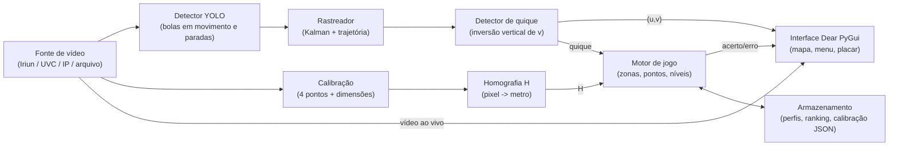
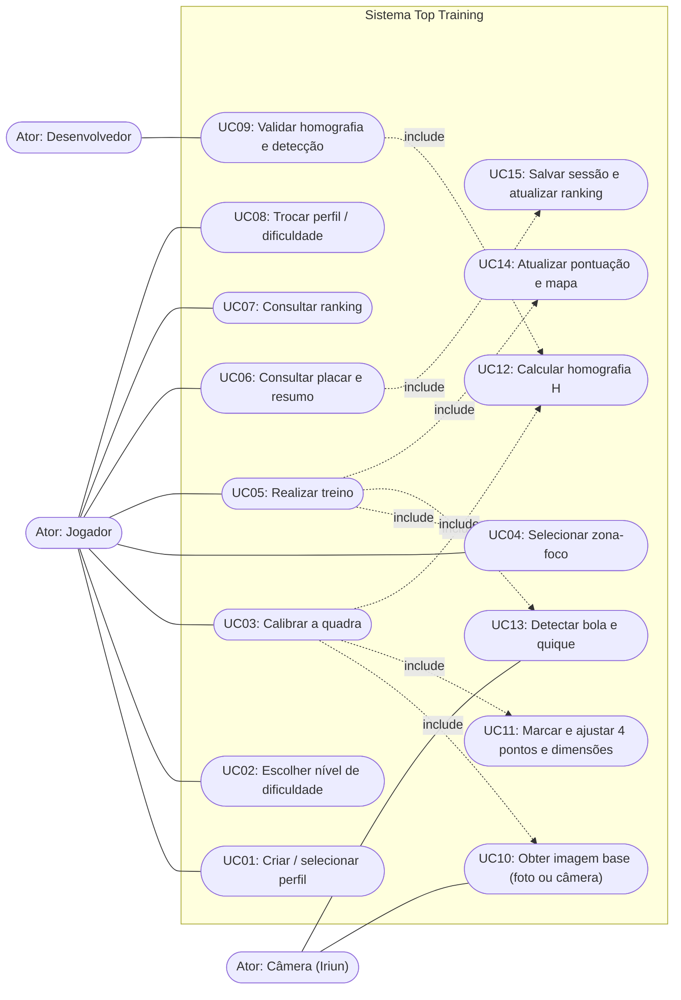
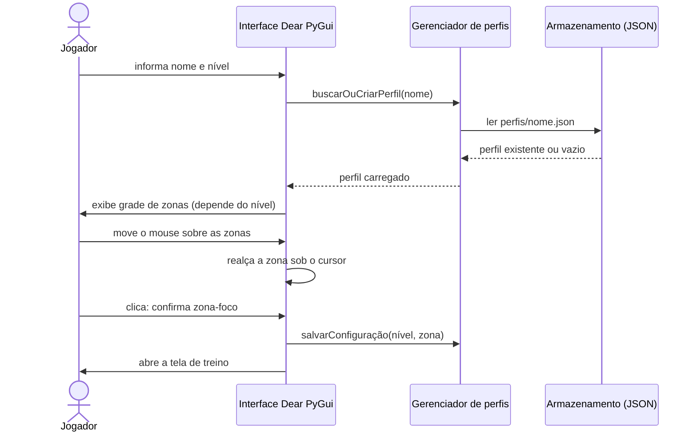
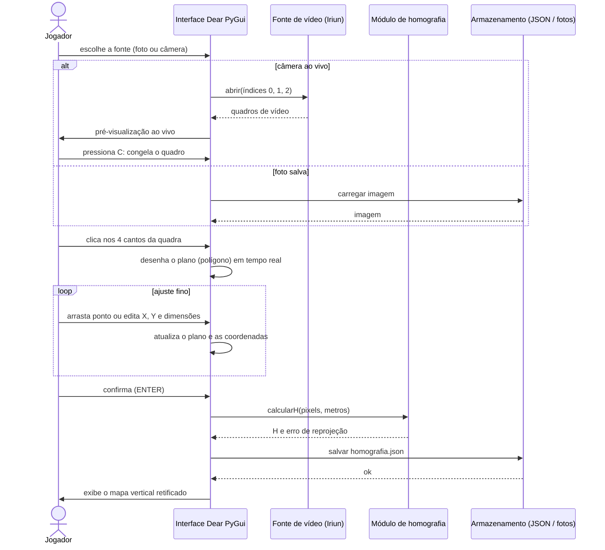
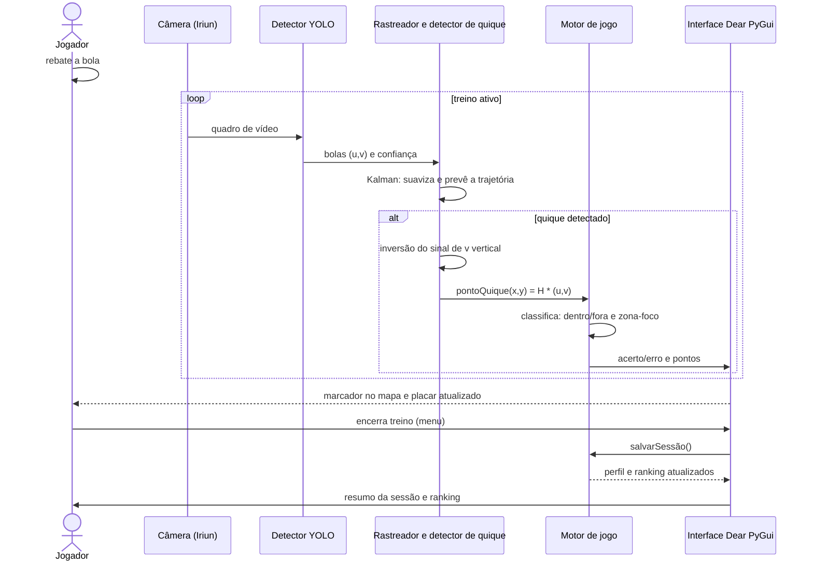

# Universidade Federal de Santa Catarina — UFSC
**Centro Tecnológico — CTC**  
**DAS5142-07220B — Projeto Integrador**

# Top Training
## Treinamento Gamificado de Tênis por Visão Computacional
### Proposta de Reformulação do Projeto — Novo Objetivo e Requisitos

- **Professores:** Leandro Buss Becker, Rodrigo Castelan Carlson
- **Integrantes:** Erik Lisboa de Almeida, Leonardo Sanches Conti, Lukas Martins Ristow
- **Local:** Florianópolis

---

## Sumário
1. [Introdução](#1-introdução)
   - [1.1 Contexto e Motivação](#11-contexto-e-motivação)
   - [1.2 Mudança de Escopo](#12-mudança-de-escopo)
   - [1.3 Objetivo Geral](#13-objetivo-geral)
   - [1.4 Objetivos Específicos](#14-objetivos-específicos)
2. [Solução Proposta](#2-solução-proposta)
   - [2.1 Cenário de Uso](#21-cenário-de-uso)
   - [2.2 Arquitetura Geral](#22-arquitetura-geral)
   - [2.3 Níveis de Dificuldade e Zonas-Foco](#23-níveis-de-dificuldade-e-zonas-foco)
   - [2.4 Telas do Aplicativo](#24-telas-do-aplicativo)
   - [2.5 Perfis e Ranking](#25-perfis-e-ranking)
   - [2.6 Tecnologias](#26-tecnologias)
3. [Diagrama de Casos de Uso](#3-diagrama-de-casos-de-uso)
4. [Diagramas de Sequência](#4-diagramas-de-sequência)
   - [4.1 Início da Sessão: Perfil, Nível e Zona-Foco](#41-início-da-sessão-perfil-nível-e-zona-foco)
   - [4.2 Calibração da Quadra](#42-calibração-da-quadra)
   - [4.3 Treino: Detecção do Quique e Pontuação](#43-treino-detecção-do-quique-e-pontuação)
5. [Requisitos](#5-requisitos)
6. [Plano de Validação](#6-plano-de-validação)
   - [6.1 Comunicação com a Câmera](#61-comunicação-com-a-câmera)
7. [Riscos](#7-riscos)
8. [Cronograma Atualizado](#8-cronograma-atualizado)

---

## 1. Introdução

### 1.1 Contexto e Motivação
O projeto *Robô Coletor de Bolas*, desenvolvido em parceria com a **Drillbot**, foi concebido para recolher automaticamente as bolas espalhadas pela quadra após o treino. Durante a Entrega 1, o grupo auditou e reproduziu em laboratório toda a cadeia herdada: captura de vídeo, retificação por homografia, detecção de bolas com YOLO, rastreamento do robô e comunicação UDP com o ESP32.

Dessa auditoria, o ativo de maior valor e menor risco foi a **cadeia de visão computacional**: o modelo YOLO já calibrado (`balls_best.pt`) detecta bolas paradas com precisão de 97,9%, recall de 95,1% e mAP50 de 97,6%. Já a parte mecânica e de controle do robô apresenta alto custo de desenvolvimento e depende de hardware que foge ao escopo de uma disciplina de um semestre.

### 1.2 Mudança de Escopo
Diante disso, o grupo decidiu **deixar o robô de lado** e concentrar o esforço em **identificação de imagens**, aproveitando o que já funciona (YOLO, homografia, câmera de celular via Iriun) para um produto novo, inspirado em sistemas comerciais de *analytics* de tênis como o SwingVision: o **Top Training**.

**Tabela 1 — Comparação entre o escopo anterior e o novo escopo:**

| Aspecto | Robô Coletor de Bolas (anterior) | Top Training (novo) |
| :--- | :--- | :--- |
| **Objetivo** | Recolher bolas com robô móvel | Identificar onde a bola quica e pontuar o jogador |
| **Câmera** | Superior, quadra inteira | Vertical, do lado oposto ao jogador, **meia quadra oposta** |
| **Saída** | Rota e comandos $(v,\omega)$ via UDP | Ponto de quique no mapa e placar do treino |
| **Interface** | Scripts e janelas OpenCV | **Dear PyGui**, tema escuro, padrão comercial |
| **Hardware** | ESP32, motores, IMU | Apenas celular (Iriun) e computador |

### 1.3 Objetivo Geral
Desenvolver um sistema de **treino gamificado de tênis** que, a partir do vídeo de um celular, mapeie a meia quadra oposta ao jogador, identifique bolas em movimento, detecte o ponto em que cada bola quica no chão e compare esse ponto com uma **zona-foco** previamente escolhida, atribuindo ou descontando pontos.

### 1.4 Objetivos Específicos
- **OE1.** **Mapear a quadra** de forma rápida e eficiente, com interface gráfica moderna, permitindo editar as dimensões e a posição de cada ponto na própria interface, sem uso de terminal.
- **OE2.** **Definir a comunicação com a câmera** (Iriun e alternativas) com baixa latência e boa taxa de quadros.
- **OE3.** **Treinar o modelo YOLO para bolas em movimento**, partindo do modelo já calibrado e melhorando-o com um novo *dataset* contendo *motion blur*.
- **OE4.** **Validar a homografia** (erro de reprojeção e erro métrico).
- **OE5.** **Validar a identificação de bolas paradas** na quadra, representadas como pontos no aplicativo.
- **OE6.** **Detectar o quique** e estimar sua posição em metros no plano da quadra.
- **OE7.** **Gamificar o treino**: perfis, níveis de dificuldade, zonas-foco, pontuação e ranking.

---

## 2. Solução Proposta

### 2.1 Cenário de Uso
O celular é posicionado do **lado oposto ao jogador**, com a quadra em orientação **vertical** na imagem. O foco da análise é a **meia quadra do lado da rede oposto ao jogador**, onde as bolas devem quicar. Somente essa metade é mapeada (largura $\times$ profundidade: $10,97 \times 11,885\text{ m}$ em duplas ou $8,23 \times 11,885\text{ m}$ em simples; valores editáveis na interface). O sistema de coordenadas tem origem $(0,0)$ no canto inferior esquerdo (linha de fundo), com o eixo $y$ crescendo em direção à rede.

### 2.2 Arquitetura Geral
A Figura 1 apresenta os módulos do sistema e o fluxo de dados entre eles.


*Figura 1 — Arquitetura modular do Top Training.*

### 2.3 Níveis de Dificuldade e Zonas-Foco
Com a quadra mapeada, o jogador escolhe um nível. Cada nível divide a meia quadra em um número diferente de zonas; antes do treino, escolhe-se a **zona-foco**.

**Tabela 2 — Níveis de dificuldade e divisão da meia quadra:**

| Nível | Zonas | Divisão |
| :--- | :---: | :--- |
| **Básico** | 2 | Quadra dividida ao meio (esquerda / direita). |
| **Médio** | 3 | Três zonas (suposição: três colunas — a confirmar). |
| **Avançado** | $\geq 6$ | Matriz de zonas (por exemplo $3\times 2$ ou $3\times 3$), número configurável. |

**Regra de pontuação (valores padrão, ajustáveis):** quique na zona-foco $\Rightarrow$ **acerto**, soma pontos ($+10$); quique fora da zona-foco ou fora da quadra $\Rightarrow$ **erro**, subtrai pontos ($-5$, mínimo zero). O sistema mantém contadores de acertos e erros e a precisão da sessão.

### 2.4 Telas do Aplicativo
O fluxo de telas é:
1. **Perfil e nível** — o programa pede um nome e o nível;
2. **Calibração** — se ainda não houver quadra calibrada;
3. **Escolha da zona-foco** — mapa vertical no centro, somente a meia quadra oposta em destaque e o restante opaco e translúcido; ao passar o mouse sobre uma zona ela é realçada, e o clique a confirma;
4. **Treino**;
5. **Resumo da sessão**;
6. **Ranking**.

A tela de treino (Figura 2) tem a quadra ao centro, um menu à esquerda (sair, trocar dificuldade, trocar perfil) e o placar à direita (pontos, acertos, erros).

```text
+-------------------------------------------------------------------------+
|  MENU                  |          REDE           |  PLACAR              |
|  [ Sair do treino    ] |  +---------+---------+  |  Pontos: 120         |
|  [ Trocar dificuldade] |  |         | ZONA    |  |  Acertos: 14 (verde) |
|  [ Trocar perfil     ] |  |   (x)   | FOCO    |  |  Erros: 5 (vermelho) |
|                        |  +---------+--(o)----+  |  Precisão: 73,7%     |
|                        |  |   (x)   |  (o)    |  |                      |
|                        |  |         |     (o) |  |                      |
|                        |  +---------+---------+  |                      |
|                        |  Meia quadra (vertical) |                      |
+-------------------------------------------------------------------------+
```
*Figura 2 — Esboço da tela de treino: menu à esquerda, mapa da quadra ao centro e placar à direita. Zona-foco em verde; quiques verdes `(o)` (acerto) e vermelhos `(x)` (erro).*

### 2.5 Perfis e Ranking
Ao digitar um nome, o perfil é criado e salvo em arquivo JSON; ao digitar o mesmo nome em outra sessão, o histórico é recuperado. Uma tela de **ranking** compara os resultados dos perfis (pontos, acertos, erros, precisão e data), separados por nível de dificuldade.

### 2.6 Tecnologias
- **Interface:** Dear PyGui (licença MIT, renderização acelerada por GPU); o mapa é desenhado em *drawlist* e o vídeo da câmera como textura dinâmica.
- **Visão:** Ultralytics YOLO (modelo base `treino_bolas_v24`), OpenCV (homografia) e filtro de Kalman.
- **Câmera:** celular via **Iriun Webcam** (USB ou Wi-Fi), com camada de abstração que aceita também câmera UVC, fluxo IP/RTSP e arquivo de vídeo.
- **Dados:** arquivos JSON locais (perfis, ranking, calibração).

---

## 3. Diagrama de Casos de Uso

A Figura 3 apresenta os casos de uso. O **Jogador** é o ator principal; a **Câmera (Iriun)** é um ator secundário (sistema externo) que fornece os quadros; o **Desenvolvedor** executa as validações técnicas.


*Figura 3 — Diagrama de casos de uso do Top Training.*

**Tabela 3 — Descrição resumida dos principais casos de uso:**

| ID | Caso de uso | Descrição |
| :--- | :--- | :--- |
| **UC01** | Criar / selecionar perfil | O jogador informa um nome; se existir, o perfil é carregado, senão é criado. |
| **UC02** | Escolher nível | Básico (2 zonas), Médio (3) ou Avançado (matriz); define a grade de zonas. |
| **UC03** | Calibrar a quadra | Obtém a imagem (foto ou câmera), marca/ajusta 4 pontos, edita dimensões e calcula $H$. |
| **UC04** | Selecionar zona-foco | Mapa vertical com zonas realçadas ao passar o mouse; clique confirma. |
| **UC05** | Realizar treino | Detecta bolas e quiques em tempo real e marca-os no mapa, pontuando acertos e erros. |
| **UC06** | Consultar placar / resumo | Exibe pontos, acertos, erros, precisão e mapa de quiques da sessão. |
| **UC07** | Consultar ranking | Compara resultados entre perfis por nível. |
| **UC08** | Trocar perfil / dificuldade | Disponível no menu esquerdo durante o treino. |
| **UC09** | Validar homografia e detecção | Mede erro de reprojeção, erro métrico, bolas paradas e quiques rotulados. |

---

## 4. Diagramas de Sequência

Os diagramas a seguir mostram, em colunas (linhas de vida), a troca de mensagens entre o usuário e os módulos do sistema ao longo do tempo. Setas cheias representam chamadas e setas tracejadas representam retornos.

### 4.1 Início da Sessão: Perfil, Nível e Zona-Foco


*Figura 4 — Diagrama de sequência: início da sessão.*

### 4.2 Calibração da Quadra


*Figura 5 — Diagrama de sequência: calibração da quadra.*

### 4.3 Treino: Detecção do Quique e Pontuação


*Figura 6 — Diagrama de sequência: treino com detecção do quique.*

---

## 5. Requisitos

A Tabela 4 lista os requisitos funcionais (RF) e não funcionais (RNF). **Prioridade:** `M` = obrigatório (*Must*); `S` = desejável (*Should*); `C` = opcional (*Could*). Os requisitos marcados com $^{\star}$ foram **acrescentados** nesta revisão, além dos citados na proposta original.

**Tabela 4 — Requisitos do Top Training:**

| ID | Requisito | Pri. | Verificação |
| :--- | :--- | :---: | :--- |
| **A.** | **Mapeamento da quadra (formato e layout da interface)** | | |
| **RF01** | Escolher a fonte da calibração: foto salva ou câmera ao vivo (Iriun). | M | Teste manual com as duas fontes. |
| **RF02** | Marcar os 4 cantos da meia quadra por clique, gerando um plano que liga os pontos em tempo real. | M | Inspeção visual. |
| **RF03** | Arrastar os pontos para ajuste fino (raio de captura de cerca de 20 px). | M | Teste manual. |
| **RF04** | Editar dimensões e coordenadas de cada ponto **na própria interface**, sem terminal. | M | Teste manual. |
| **RF05** | Calcular a homografia e exibir o mapa vertical retificado, somente com as linhas. | M | Comparação com as medidas oficiais. |
| **RF06$^{\star}$** | Salvar e carregar a calibração, reutilizando-a entre sessões. | S | Reabrir o aplicativo e conferir. |
| **RF07$^{\star}$** | Alternar entre quadra de simples (8,23 m) e de duplas (10,97 m). | S | Teste manual. |
| **B.** | **Câmera e comunicação** | | |
| **RF08** | Abstração da fonte de vídeo (Iriun, UVC, IP/RTSP e arquivo de vídeo). | M | Trocar de fonte sem alterar o restante do código. |
| **RF09$^{\star}$** | Detectar automaticamente o índice da câmera e reconectar após queda. | S | Desconectar e reconectar durante a execução. |
| **RF10$^{\star}$** | Reproduzir vídeo gravado como se fosse câmera (testes sem hardware). | S | Executar os vídeos de teste. |
| **RF11$^{\star}$** | Exibir FPS e latência na interface (modo depuração). | C | Leitura na tela. |
| **C.** | **Visão computacional** | | |
| **RF12** | Detectar bolas **em movimento** com YOLO retreinado em *dataset* com *motion blur*. | M | mAP50 e recall no conjunto de validação. |
| **RF13$^{\star}$** | Rastrear a trajetória (Kalman e associação), mantendo as últimas $N$ posições. | M | Trajetória contínua em vídeo. |
| **RF14$^{\star}$** | Detectar o **quique** (inversão do movimento vertical) e estimar o ponto de contato em metros. | M | Comparação com vídeos rotulados à mão. |
| **RF15$^{\star}$** | Classificar o quique: dentro/fora da quadra e dentro/fora da zona-foco. | M | Matriz de confusão. |
| **RF16** | Exibir bolas **paradas** na quadra como ponto no mapa. | S | Bolas em posições conhecidas. |
| **RF17$^{\star}$** | Filtrar falsos positivos (região da quadra, confiança e tamanho). | S | Taxa de falsos positivos em vídeo. |
| **D.** | **Treino gamificado e aplicação** | | |
| **RF18** | Perfis por nome, persistidos em JSON; o mesmo nome recupera o histórico. | M | Fechar e reabrir o aplicativo. |
| **RF19** | Níveis Básico (2 zonas), Médio (3 zonas) e Avançado (matriz de zonas). | M | Teste unitário da divisão em zonas. |
| **RF20** | Tela de seleção da zona-foco com realce ao passar o mouse; restante da quadra opaco e translúcido. | M | Inspeção visual. |
| **RF21** | Pontuação: acerto soma e erro subtrai pontos; contadores de acertos e erros. | M | Teste unitário. |
| **RF22** | Tela de treino: quadra ao centro, menu à esquerda (sair, trocar dificuldade, trocar perfil) e placar à direita. | M | Inspeção visual. |
| **RF23** | Marcadores de quique no mapa (verde = acerto, vermelho = erro). | M | Simulação de quiques. |
| **RF24** | Tela de ranking comparando perfis por nível. | M | Teste com perfis fictícios. |
| **RF25$^{\star}$** | Resumo da sessão (precisão e mapa de calor dos quiques). | S | Inspeção visual. |
| **RF26$^{\star}$** | Histórico e evolução por perfil. | C | Gráfico por sessão. |
| **RF27$^{\star}$** | Feedback sonoro e visual de acerto e erro. | C | Teste manual. |
| **E.** | **Requisitos não funcionais** | | |
| **RNF01** | Interface com **Dear PyGui**, tema escuro e aparência de produto comercial. | M | Revisão de design. |
| **RNF02** | Pipeline com pelo menos 30 FPS com GPU (15 FPS em CPU); captura preferencialmente a 60 FPS. | S | Medição de FPS. |
| **RNF03** | Latência do quique até o marcador de no máximo 500 ms. | S | Cronometragem com vídeo. |
| **RNF04** | Homografia com erro de reprojeção de no máximo 5 px e erro métrico de no máximo 15 cm em pontos de teste. | M | Validação com marcações conhecidas. |
| **RNF05** | Bolas paradas: erro de posição de no máximo 15 cm e recall de pelo menos 95%. | M | Bolas em posições medidas. |
| **RNF06** | Bolas em movimento: mAP50 de pelo menos 0,90 e recall de pelo menos 0,85 no conjunto com *blur*. | M | Validação do modelo (`model.val()`). |
| **RNF07** | Classificação do quique por zona com acerto de pelo menos 90%. | M | Vídeos rotulados. |
| **RNF08** | Execução offline em Windows 10/11. | M | Teste sem internet. |
| **RNF09** | Licenças compatíveis com comercialização (atenção à AGPL do Ultralytics). | S | Auditoria de licenças. |
| **RNF10** | Uso por leigos: calibrar em poucos passos (até 2 min). | S | Teste de usabilidade. |
| **RNF11** | Dados em JSON legível. | S | Inspeção. |
| **RNF12$^{\star}$** | Testes automatizados (`pytest`) de homografia, zonas, pontuação e detecção de quique. | S | Execução local dos testes. |

---

## 6. Plano de Validação

**Tabela 5 — Validações previstas:**

| Validação | Procedimento | Métrica / critério |
| :--- | :--- | :--- |
| **Homografia** | Marcar interseções de linhas conhecidas e comparar as coordenadas calculadas com as oficiais. | Erro de reprojeção (px) $\leq 5$; erro métrico $\leq 15\text{ cm}$. |
| **Bolas paradas** | Posicionar bolas em coordenadas medidas e conferir o ponto no mapa. | Erro de posição $\leq 15\text{ cm}$; recall $\geq 95\%$. |
| **Bolas em movimento** | Avaliar o YOLO retreinado em vídeos com *blur*. | mAP50 $\geq 0,90$; recall $\geq 0,85$. |
| **Quique** | Comparar eventos detectados com quiques rotulados manualmente em vídeo. | Acerto na zona $\geq 90\%$; latência $\leq 500\text{ ms}$. |
| **Comunicação** | Medir FPS e latência com Iriun (USB e Wi-Fi) e arquivo de vídeo. | FPS $\geq 30$; latência estável. |

### 6.1 Comunicação com a Câmera

**Tabela 6 — Alternativas de comunicação câmera–computador:**

| Opção | Vantagens | Pontos a validar |
| :--- | :--- | :--- |
| **Iriun Webcam (atual)** | Já usada no projeto anterior; USB ou Wi-Fi; aparece como webcam. | Dependência de aplicativo de terceiros; limites da versão gratuita. |
| **Câmera USB (UVC)** | Padrão nativo, sem *driver* extra, licença limpa. | Menor flexibilidade de posicionamento. |
| **Fluxo IP / RTSP** | Dispensa *driver* no computador. | Latência maior; configuração de rede. |
| **Arquivo de vídeo** | Reprodutível; ideal para testes. | Não é tempo real. |

---

## 7. Riscos

- **Licença:** o Ultralytics YOLO é distribuído sob AGPL-3.0; a comercialização exige licença *Enterprise* ou um modelo alternativo de licença permissiva.
- **Bolas borradas:** a bola em movimento aparece alongada; o recall do modelo atual tende a cair. Mitigação: novo *dataset* e *fine-tuning*.
- **Taxa de quadros e exposição** do celular: 30 FPS e exposição longa agravam o *blur*. Mitigação: 60 FPS e exposição curta.
- **Oclusão** da bola por jogador ou rede.
- **Paralaxe:** a homografia só vale para pontos no plano do chão; por isso o ponto estimado é o do instante do quique.

**Questões em aberto:**
1. Zonas do nível Médio (colunas ou faixas de profundidade);
2. Valores de pontuação e penalidade para bola fora da quadra;
3. Quadra de simples ou duplas como padrão;
4. Ranking global ou por período.

---

## 8. Cronograma Atualizado

**Tabela 7 — Proposta de cronograma para as semanas restantes (S8 a S17):**

| Atividade | S8 | S9 | S10 | S11 | S12 | S13 | S14 | S15 | S16 | S17 |
| :--- | :-: | :-: | :-: | :-: | :-: | :-: | :-: | :-: | :-: | :-: |
| Reformulação do escopo, requisitos e documentação | X | X | | | | | | | | |
| Interface Dear PyGui: telas e navegação | | X | X | X | | | | | | |
| Calibração na interface, homografia e validação | | | X | X | X | | | | | |
| Camada de câmera (Iriun, UVC, arquivo) | | | X | X | | | | | | |
| **Marco: Entrega 2 (apres. 19–21/10)** | | | | **E2** | | | | | | |
| *Dataset* de bolas em movimento e *fine-tuning* do YOLO | | | X | X | X | X | | | | |
| Rastreamento e detecção de quique | | | | | X | X | X | | | |
| Integração: quique $\rightarrow$ pontuação $\rightarrow$ ranking | | | | | | | X | X | | |
| Testes em quadra e validações | | | | | | | | X | X | |
| Relatório final e apresentação | | | | | | | | | X | X |
| **Marco: Entrega 3 (apres. 30/11–03/12)** | | | | | | | | | | **E3** |

